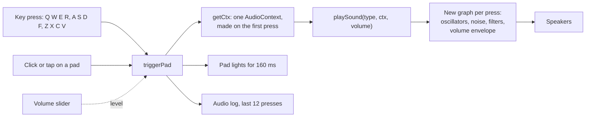
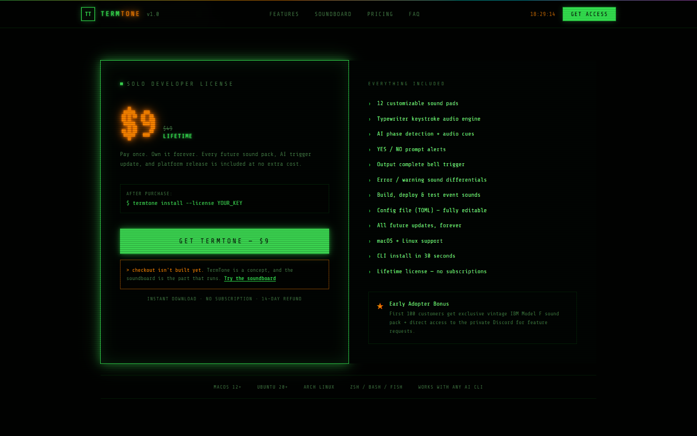

# TermTone

A retro terminal soundboard: twelve sounds for terminal and AI agent events, synthesised live in the browser, on a concept page for a command-line tool I haven't built yet.

**Live:** [v0-retro-terminal-soundboard.vercel.app](https://v0-retro-terminal-soundboard.vercel.app) | **Built:** April 2026, reworked October 2026

## The idea

An AI agent or a long script works in the terminal for minutes, then finishes, fails or stops to ask a yes or no question. If you aren't watching, you miss it. TermTone gives each of those events its own sound.

It's one of a few conceptual attempts at an architecture I wanted out of my head and running. The data is the terminal's output stream. The hook would be a small daemon wrapping the shell. Detection would name the event: thinking, done, failed or waiting on you. The output is one sound per event. I built the sound end first, as a playable soundboard, because it's the part you can judge in ten seconds.

## How it works

One static page in Next.js 16, React 19, TypeScript and Tailwind CSS v4, prerendered at build time. There is no back end.

The working part is `components/soundboard-section.tsx`. Twelve pads map to twelve keys (Q W E R, A S D F, Z X C V) that work anywhere on the page. The first press creates one shared `AudioContext`. Each press calls `playSound()`, which builds a fresh Web Audio graph from oscillators, noise, filters and a volume envelope, so there are no audio files. Each event has its own shape: rising notes for yes, falling notes for no, a falling buzz for an error, a pulsing drone while an agent thinks.



## Status

Live and working as of 29 October 2026: all twelve sounds from keyboard, mouse or touch, the volume slider, the audio log and a stats panel that reads the real sample rate and latency. The CLI, the daemon and the event detection are still ideas, and the page labels itself a concept. The buy button says checkout isn't built.

## How I built it

I wrote the concept and spec and built it by directing v0, Vercel's AI app builder. v0's first pass gave eight pads one shared plain tone and a volume slider that moved without changing anything. My next prompt got a recipe per pad and the slider wired in. In October 2026 I reworked it with Claude Code: one tap on a phone no longer plays the sound twice, the dead controls work or say what they are, the stats show real numbers, and type errors are no longer ignored at build time. I don't hand-write the code.

## Screenshots





## Run it locally

You need Node.js 20.9 or newer. No environment variables are needed.

```bash
npm install
npm run dev
```

Open http://localhost:3000 and press Q W E R, A S D F or Z X C V, or click a pad.

This repository is a snapshot of the code as of 2026-10-29. The working repository is private.
