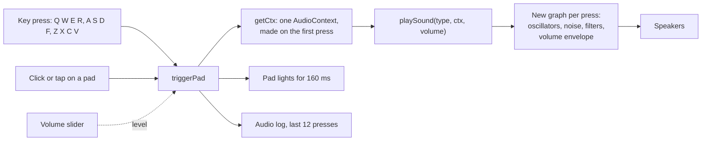
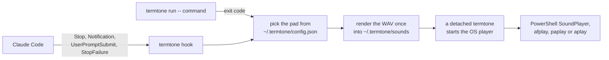
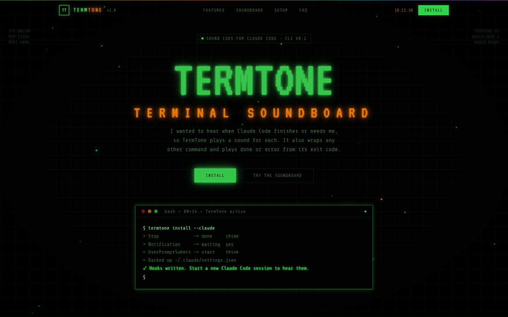
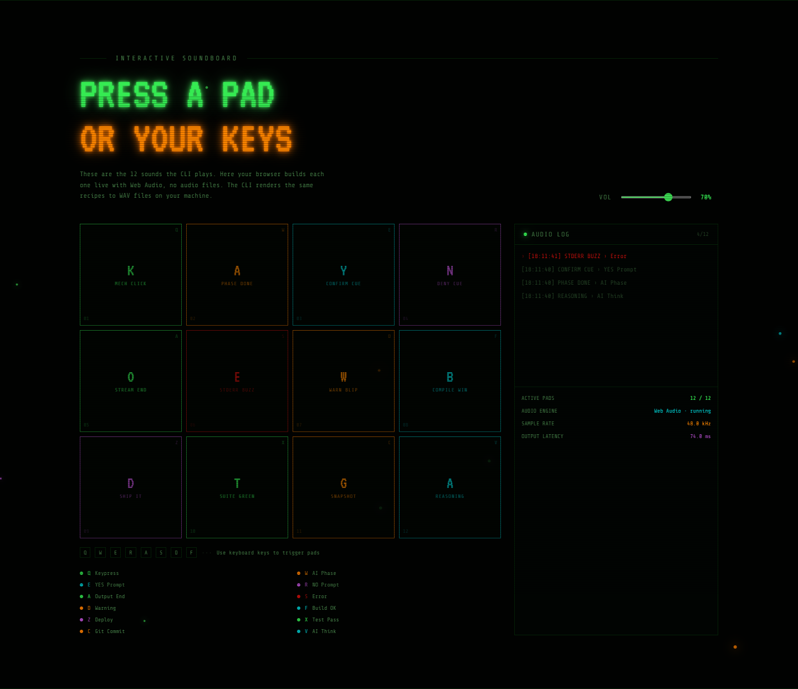
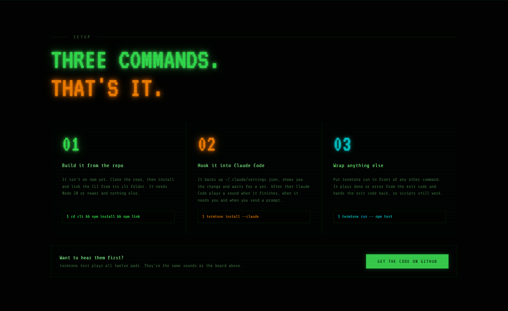
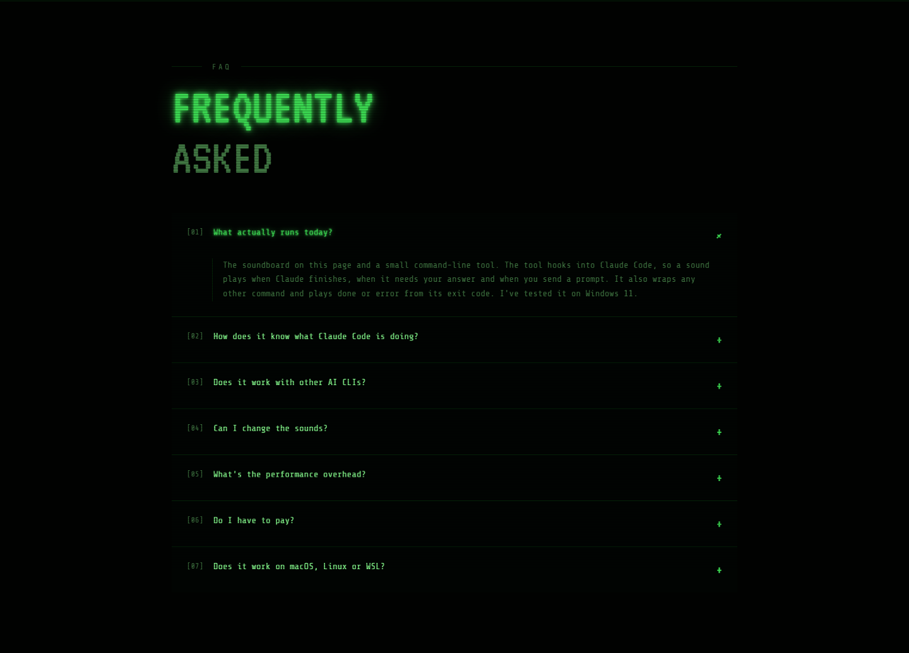

# TermTone

A retro terminal soundboard, and a small command-line tool that plays its sounds when Claude Code finishes, when it needs you, and when any command you run ends.

**Live:** [v0-retro-terminal-soundboard.vercel.app](https://v0-retro-terminal-soundboard.vercel.app) | **Built:** April 2026, reworked October 2026, CLI added October 2026

## Install

The CLI isn't on npm, so you build it from this repository. It needs Node 20 or newer and nothing else.

```bash
git clone https://github.com/Cruisercc3/termtone.git
cd termtone/cli
npm install
npm link
termtone test
termtone install --claude
```

`npm install` builds it and `npm link` puts `termtone` on your path. `termtone test` plays all twelve sounds. `termtone install --claude` shows you the change to `~/.claude/settings.json` and asks before writing it. For any other command, put `termtone run --` in front of it.

I've only run it on Windows 11. The macOS and Linux players are written, but I haven't tested them.

## The idea

An AI agent or a long script works in the terminal for minutes, then finishes, fails or stops to ask a yes or no question. If you aren't watching, you miss it. TermTone gives each of those events its own sound.

It started as one of a few conceptual attempts at an architecture I wanted out of my head and running. The plan was a daemon wrapping the shell that read the output stream and guessed the event from it. I built the sound end first, as a playable soundboard, because it's the part you can judge in ten seconds.

When I came back to build the rest, Claude Code turned out to have hooks that say exactly when a turn ends or when it's waiting on you. So the CLI listens to those instead of guessing from the output, and there's no daemon at all.

## How the site works

One static page in Next.js 16, React 19, TypeScript and Tailwind CSS v4, prerendered at build time. There is no back end.

The soundboard is `components/soundboard-section.tsx`. Twelve pads map to twelve keys (Q W E R, A S D F, Z X C V) that work anywhere on the page. The first press creates one shared `AudioContext`. Each press calls `playSound()`, which builds a fresh Web Audio graph from oscillators, noise, filters and a volume envelope, so there are no audio files. Each event has its own shape: rising notes for yes, falling notes for no, a falling buzz for an error, a pulsing drone while an agent thinks.



## How the CLI works

The CLI is in `cli/`, in Node and TypeScript with no runtime dependencies. Its own README has the details.



- `termtone install --claude` adds four hooks to `~/.claude/settings.json`. It backs the file up, shows the diff and asks before writing, and leaves every other hook alone. The hooks run in the background, so Claude Code never waits for a sound.
- `termtone run -- <command>` runs anything and plays done or error from the exit code, then hands that exit code back.
- The sounds are the site's twelve recipes, ported to a small offline renderer that follows the Web Audio spec and writes WAV files. The OS plays them with what it already has.

## Status

Working as of 30 October 2026:

- **The site.** All twelve sounds from keyboard, mouse or touch, the volume slider, the audio log and a stats panel that reads the real sample rate and latency.
- **The CLI, on Windows 11.** In real Claude Code sessions the start, done and waiting sounds all played, and so did the optional tick before each tool. The hooks didn't change what Claude did. The waiting sound fired when a permission prompt went unanswered for about six seconds. `termtone run` played done and error and passed exit codes through, npm's `.cmd` files included. Uninstalling gives the settings file back byte for byte. 18 tests pass.
- **The sounds match the site.** Checked in Chrome 152 by rendering each pad both ways: 11 of 12 match sample for sample, and the twelfth differs only by a timing quirk in Chrome that you can't hear.

Not tested yet: macOS and Linux. Their players are written, but Windows 11 is the only place I've run TermTone. Also untested: the error sound from a Claude Code API failure and the idle reminder Claude Code sends after a minute.

Not built: keystroke sounds, matching patterns in other tools' output, your own sound files and hooks for other agents. It isn't on npm, and nothing is for sale.

## How I built it

I wrote the concept and spec and built the site by directing v0, Vercel's AI app builder. v0's first pass gave eight pads one shared plain tone and a volume slider that moved without changing anything. My next prompt got a recipe per pad and the slider wired in.

In October 2026 I reworked it with Claude Code: one tap on a phone no longer plays the sound twice, the dead controls work or say what they are, the stats show real numbers, and type errors are no longer ignored at build time. Then I had Claude Code build the CLI against Claude Code's own hooks, check the ported sounds against the browser sample by sample, and run it in real sessions on my machine before any of the copy said it works. I don't hand-write the code.

## Screenshots









## Run the site locally

The site needs Node.js 20.9 or newer and no environment variables:

```bash
npm install
npm run dev
```

Open http://localhost:3000 and press Q W E R, A S D F or Z X C V, or click a pad. The CLI's install steps are at the top.

This repository is a snapshot of the code as of 2026-10-30. The working repository is private.
