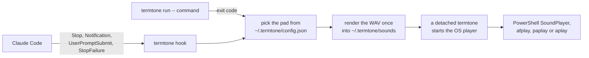

# termtone CLI

Plays a sound when Claude Code finishes, when it needs you, and when any command you wrap exits. The sounds are the twelve pads from the TermTone soundboard, rendered to WAV files on your machine and played with the audio player your OS already has.

## Install

It isn't on npm yet. From this folder:

```bash
npm install
npm link
```

That builds it and puts `termtone` on your path. It needs Node 20 or newer and has no runtime dependencies.

## Use

```bash
termtone install --claude        # add the Claude Code hooks (shows the diff and asks first)
termtone run -- npm test         # run anything, then hear done or error
termtone test                    # play all twelve pads
termtone play chime              # play one: a pad name, 1 to 12, or an event name
termtone list                    # the pads, and which event plays which
termtone status                  # config, audio player and installed hooks
termtone log                     # what the hooks and runs played
termtone uninstall --claude      # take the hooks out again
```

## Events

| Event | When | Default pad |
|---|---|---|
| `start` | you send Claude Code a prompt (`UserPromptSubmit`) | think |
| `waiting` | Claude Code needs you: a permission prompt or idle input (`Notification`) | yes |
| `done` | Claude Code finishes its turn (`Stop`), or a wrapped command exits 0 | chime |
| `error` | Claude Code's turn ends on an API error (`StopFailure`), or a wrapped command fails | error |
| `working` | Claude Code is about to use a tool (`PreToolUse`, only with `install --claude --working`) | click |

Change them in `~/.termtone/config.json`. Each event takes a pad name or `"off"`, and `volume` goes from 0 to 400. 70 is the soundboard's default and 100 its loudest.

```json
{
  "volume": 70,
  "events": {
    "start": "think",
    "working": "click",
    "waiting": "yes",
    "done": "chime",
    "error": "error"
  }
}
```

## How it works



- **The sounds.** `src/synth.ts` is a small offline copy of the Web Audio pieces the soundboard uses: oscillators, gains, biquad filters, noise buffers and the three automation ramps, written to the Web Audio spec. `src/recipes.ts` is the site's `playSound()` almost line for line on top of it. Each pad renders once to a 16-bit WAV.
- **The hooks.** `install --claude` writes exec-form hooks (`command` is node, `args` is this script) with `async: true`. No shell is involved, so a path like `C:\Program Files\nodejs\node.exe` needs no quoting, and Claude Code never waits for a sound. The hook prints nothing and always exits 0, because on `UserPromptSubmit` anything printed would reach Claude as context.
- **Playing in the background.** The hook hands the sound to a detached copy of termtone and exits. It has to be Node in the middle: a detached process on Windows gets no console, and `powershell.exe` without one quits at once without playing. The background copy starts the player normally and logs whether it really played.
- **Running commands.** On Windows, npm and friends are `.cmd` files that only start through `cmd.exe`, so those go through cmd with every argument escaped for it. A `.exe` runs directly. The exit code is passed back untouched.

## Checks

- `npm test` runs 18 tests: the automation maths, every pad's length and level, the WAV header, the settings merge (other hooks kept, a second install changes nothing, uninstall gives the file back as it was), and Windows argument quoting through a real npm-style `.cmd` shim.
- `npm run port-check` serves a page that renders every pad with the site's real `playSound()` in the browser and with this renderer, and compares them. In Chrome 152, 11 of 12 pads match sample for sample (correlation 0.999 or more, energy within 2%). The `commit` pad's envelope matches but its samples correlate at 0.81, because Chrome holds a frequency change in that recipe until the next 128-sample block and this renderer applies it on the exact sample, as the spec says. You can't hear the difference.
- Tested on Windows 11 with Node 24 and Claude Code 2.1.310. The macOS and Linux players are written but haven't been run.
